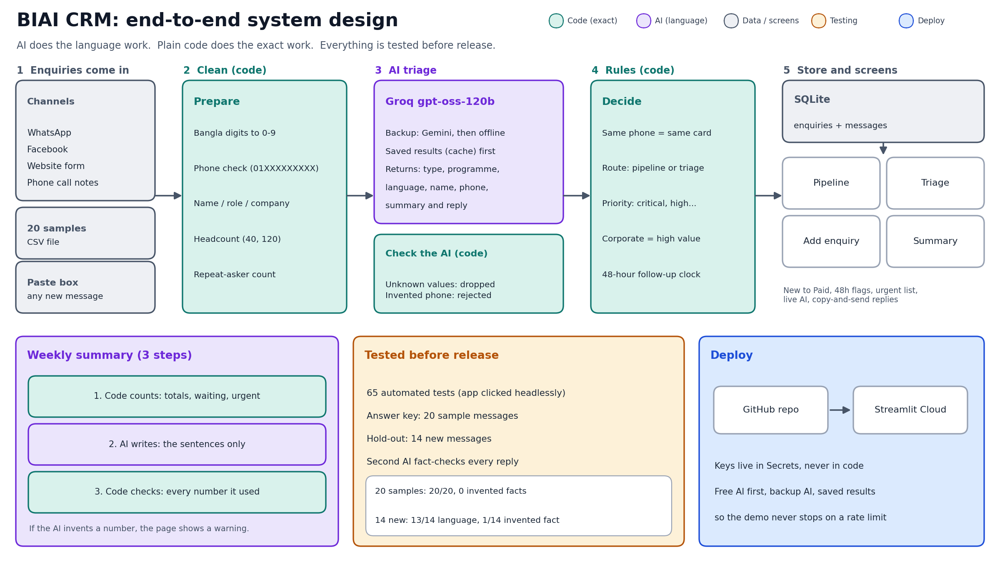

# BIAI CRM (Round 2, Task 1)

A small CRM for BIAI's enquiries (WhatsApp, Facebook, website, phone notes).
AI reads a pasted message, fills in the details, and suggests a reply in the sender's language.

**Live demo:** https://biai-crm-trino.streamlit.app/  |  **Video:** `<paste the Loom link>`



## Screens
1. **Pipeline** – New, Contacted, Interested, Paid, Lost. Badges for high-value, repeat askers and "waiting 48h+". One-click "Contacted".
2. **Triage** – urgent, support, job seekers, school students, spam. Kept out of the sales pipeline.
3. **Add enquiry** – paste a message, AI fills the form and writes a reply (English, Banglish or Bangla).
4. **Weekly summary** – numbers counted by code, sentences written by AI, numbers checked by code afterwards.

## Where AI is used, and where it is not
| AI (language work) | Plain code (exact work) |
|---|---|
| classify the message (lead, faq, support, urgent, spam, job, minor) | Bangla digits, phone validation, finding numbers in text |
| extract name, company, role, programme, headcount | duplicate detection (same phone = same person) |
| write the reply in the sender's language | routing, priority, the 48-hour clock |
| write the weekly summary sentences | every number in the summary; checks the AI's numbers |
| second AI pass: fact-check each reply for invented claims | refuses any phone number that is not in the message |

## Run it
```
python -m venv .venv && .venv\Scripts\activate        # Windows (Mac/Linux: source .venv/bin/activate)
pip install -r requirements.txt
copy .streamlit\secrets.toml.example .streamlit\secrets.toml   # then add your keys
python -m pytest -q tests
streamlit run app.py
```
The 20 sample enquiries load from `data/analysis_cache.json` (saved AI results) so the demo never depends on a live API call.
Regenerate it with `python run_eval.py --providers groq --save-cache`.

## How it was tested
- `tests/`: unit tests for the exact parts, plus the real Streamlit app clicked through headlessly with a fake AI.
- `python run_eval.py --providers groq` scores the AI on the 20 sample messages against a hand-made answer key.
- `python run_eval.py --providers groq --set holdout` scores 14 new messages the prompt was never tuned on.
- A second AI pass fact-checks every reply (`INVENTED FACT` lines).

## Results (5 Nov 2026, Groq `openai/gpt-oss-120b`, prompt v4)
| Set | kind | want | language | phone | name | replies with an invented fact |
|---|---|---|---|---|---|---|
| 20 sample messages | 20/20 | 20/20 | 20/20 | 20/20 | 20/20 | 0/20 |
| 14 hold-out messages | 14/14 | 14/14 | 13/14 | 14/14 | 14/14 | 1/14 |

The 20 samples were used while building the prompt, so the 14 hold-out messages are the honest number.
The one hold-out failure is a parent writing in Banglish about a class-8 child (#109): the AI called it Bangla,
replied in Bangla script instead of Banglish, and wrote "we can consider" (a claim about eligibility).

What went wrong first: the first prompt invented facts in 5 of 20 replies (class format, job chances,
what "add-on" means, "we can arrange instalments"). My own scorer missed it because it only looked for prices;
I found it by reading the replies. Fixed with stricter rules plus the second-AI fact check.
Later runs of the fact check also caught two smaller slips (saying what the channel is for, agreeing to call "after 6 pm"), now fixed in the prompt.
The answer key is written by me, and the hold-out set is small (14), so treat these as "good on this kind of message", not "always right".

## Decisions
- Free Groq model (`openai/gpt-oss-120b`) first, Gemini as backup, then an offline guess, so the demo never dies on a rate limit.
- The AI is never trusted for exact things: phones, duplicates, dates and counts are code.
- Replies never state facts about BIAI (prices, schedule, formats): the AI was given none, so it says "the team will confirm".

## What does not work yet
- Data lives in memory for one browser session (no shared database, no login).
- Duplicates are matched by phone number only.
- Messages are pasted by hand; no WhatsApp/Facebook connection.
- Tested on 34 messages only; Bangla and Banglish quality judged by me. Replies are a little formulaic.
- The fact-check is AI checking AI, so it can miss things or flag harmless ones.
- Language is decided by the AI. It got one Banglish message wrong (#109). The code already has a language detector, so the fix is to let code decide and tell the AI.
- The demo clock is fixed (28 Oct 2026, 17:00) because the sample data is from 26-27 Oct.

## Next
- A real database and staff login; assign enquiries to people.
- WhatsApp Business / Facebook webhooks so messages arrive on their own.
- An approved FAQ and price list for the AI to use, so it can answer safely instead of "the team will confirm".
- A review screen where staff edit replies, and learn from the edits.
- Reminders by email/WhatsApp for the 48-hour rule; more test messages from real (anonymised) enquiries.

## AI tools used
Claude (planning, code, tests, reviewing replies), DeepSeek (first problem breakdown), Groq `openai/gpt-oss-120b` and Gemini (inside the app).
