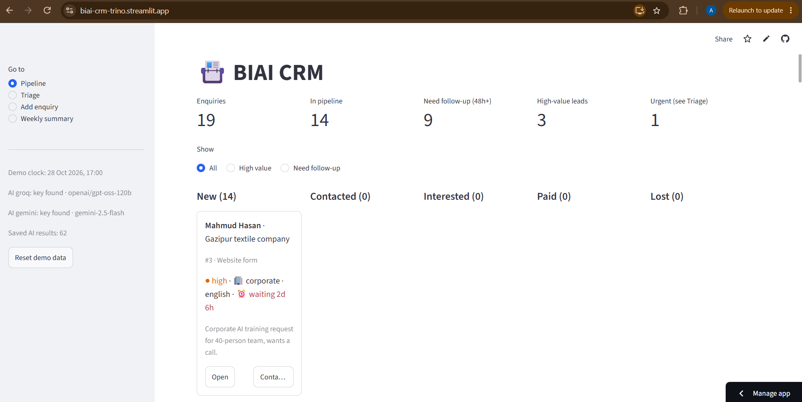
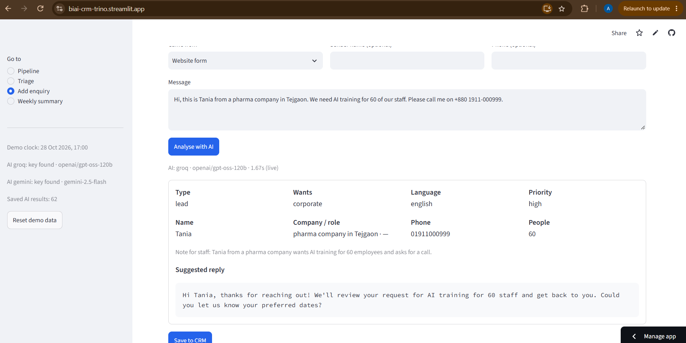
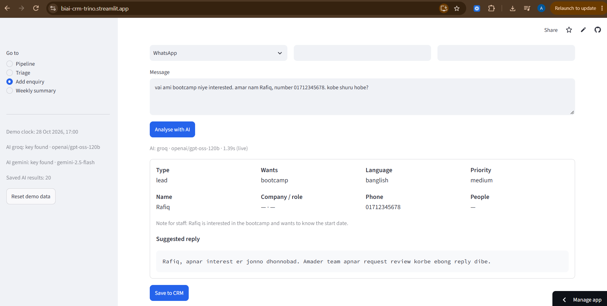
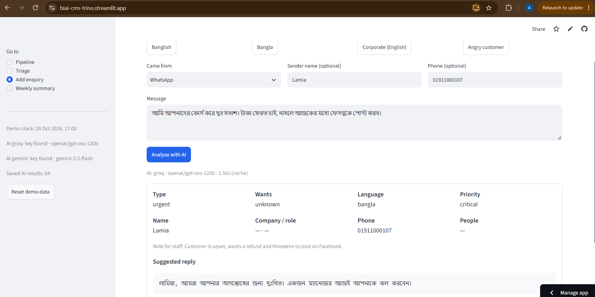
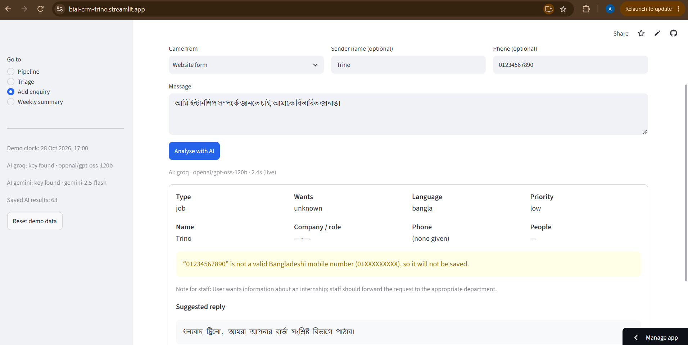
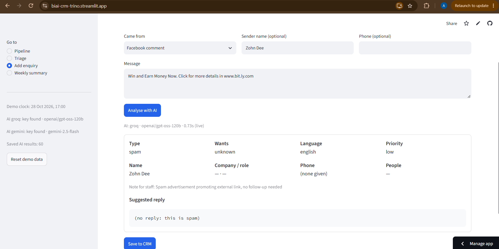

# BIAI CRM (Round 2, Task 1)

A small CRM for BIAI's enquiries (WhatsApp, Facebook, website, phone notes).
AI reads a pasted message, fills in the details, and suggests a reply in the sender's language.

**Live demo:** https://biai-crm-trino.streamlit.app/  |  **Video:** `<paste the Loom link>`

## Screens
1. **Pipeline** – New, Contacted, Interested, Paid, Lost. Badges for high-value, repeat askers and "waiting 48h+". One-click "Contacted".
2. **Triage** – urgent, support, job seekers, school students, spam. Kept out of the sales pipeline.
3. **Add enquiry** – paste a message, AI fills the form and writes a reply (English, Banglish or Bangla).
4. **Weekly summary** – numbers counted by code, sentences written by AI, numbers checked by code afterwards.

### Screenshots

<table align="center">
  <tr>
    <td align="center" width="50%">
       
      <b>CRM Pipeline</b>
    </td>
    <td align="center" width="50%">
       
      <b>Lead English Reply</b>
    </td>
  </tr>
  <tr>
    <td align="center" width="50%">
       
      <b>Lead Banglish Reply</b>
    </td>
    <td align="center" width="50%">
       
      <b>Urgent Bangla Reply</b>
    </td>
  </tr>
  <tr>
    <td align="center" width="50%">
       
      <b>Job Bangla Reply</b>
    </td>
    <td align="center" width="50%">
       
      <b>Spam Reply</b>
    </td>
  </tr>
</table>

## Where AI is used, and where it is not
| AI (language work) | Plain code (exact work) |
|---|---|
| classify the message (lead, faq, support, urgent, spam, job, minor) | Bangla digits, phone validation, finding numbers in text |
| extract name, company, role, programme, headcount | duplicate detection (same phone = same person) |
| write the reply in the sender's language | routing, priority, the 48-hour clock |
| write the weekly summary sentences | every number in the summary; checks the AI's numbers |
| second AI pass: fact-check each reply for invented claims | refuses any phone number that is not in the message |

## Run it
